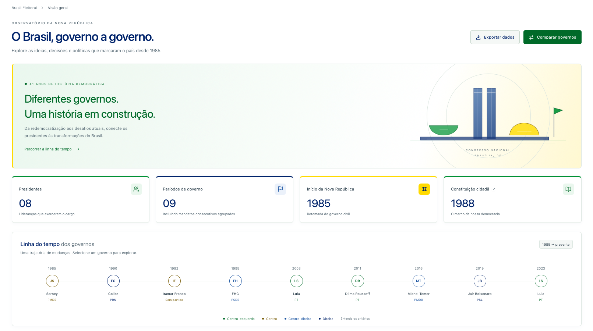
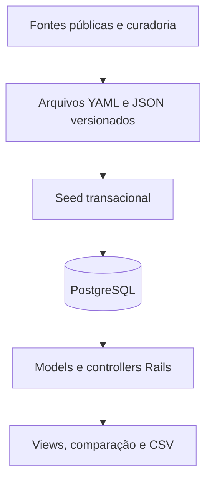

# Brasil Eleitoral
### Finalidade acadêmica e caráter não partidário:
* Finalidade acadêmica e caráter não partidário: este projeto foi desenvolvido exclusivamente para estudo e prática de engenharia de software, modelagem e apresentação de dados públicos. Não tem finalidade de propaganda político-partidária, apoio ou oposição a partidos, candidatos ou governos. A inclusão de informações históricas e classificações políticas não representa o posicionamento pessoal do autor. As fontes, os recortes e os critérios editoriais estão documentados para permitir a verificação e a discussão crítica do conteúdo.
Dashboard para explorar os governos da Nova República desde 1985, comparar gestões e consultar resultados eleitorais com fontes identificadas.



[Problema e solução](#sec-problema-e-solucao) · [Arquitetura](#sec-arquitetura) · [Desafios técnicos](#sec-desafios-tecnicos) · [Executar localmente](#sec-executar-localmente) · [Testes](#sec-testes)

<a id="sec-problema-e-solucao"></a>

## Problema e solução

Dados sobre governos, eleições e indicadores econômicos estão distribuídos entre arquivos e páginas de diferentes órgãos. Reuni-los em um painel exige organizar formatos distintos, representar sucessões e períodos de governo e preservar a origem das informações.

O projeto reúne esse conteúdo em um catálogo versionado, importado para o PostgreSQL e apresentado em uma interface Rails com busca, comparação e exportação. A navegação consulta o banco local, sem chamadas a APIs externas para carregar o catálogo.

A decisão favorece rastreabilidade e disponibilidade durante a consulta. Em contrapartida, a atualização depende de curadoria, revisão dos arquivos e nova execução da carga; os dados não são atualizados em tempo real.

## Funcionalidades

- Linha do tempo com 8 presidentes e 9 períodos de governo.
- Busca por nome, partido ou agenda e filtros por posição e década.
- Perfis com contexto, economia, políticas públicas, marcos e fontes.
- Formas de chegada ao poder, sucessões, candidaturas por turno e coligações de 1985 a 2022.
- Comparação de duas gestões lado a lado.
- Gráfico do IPCA com 30 observações do IBGE, de 1995 a 2024.
- Exportação CSV em UTF-8 que respeita os filtros selecionados.
- Layout responsivo, menu móvel e página de metodologia.

<a id="sec-arquitetura"></a>

## Arquitetura

A coleta e a conferência acontecem antes da navegação. O seed resolve referências entre os arquivos e persiste o catálogo em uma única transação.



| Parte | Responsabilidade |
| --- | --- |
| `db/data/` | Catálogo, resultados eleitorais, sucessões e observações econômicas. |
| `db/seeds.rb` | Resolver referências e criar ou atualizar registros por slug ou ano. |
| `President` e `Administration` | Separar a pessoa dos períodos em que exerceu o governo. |
| `EconomicObservation` | Persistir as observações anuais do IPCA. |
| `Administration.filtered` | Compor busca, posição e intervalo temporal. |
| `DashboardController` | Preparar páginas, comparação e exportação dos dados filtrados. |
| Views e helpers | Apresentar o catálogo, gráficos, fontes e critérios editoriais. |

### Tecnologias e decisões

- **Ruby 4.0.5 e Rails 8.1.4:** aplicação integrada, com renderização no servidor.
- **PostgreSQL:** relações entre pessoas e governos, além de JSONB para a estrutura de chegada ao poder e eleições associadas.
- **Tailwind CSS 4 via `tailwindcss-rails`:** compilação local e tema centralizado em `app/assets/tailwind/application.css`.
- **Turbo, Stimulus e Importmap:** interações no frontend sem exigir Node ou uma aplicação React separada.
- **Docker Compose:** ambiente de desenvolvimento com aplicação e PostgreSQL 18, sem instalar a stack diretamente no macOS.
- **Minitest e Selenium/Chrome:** verificação das regras do domínio, requisições e navegação.

O projeto não utiliza MongoDB nem Redis. A modelagem combina relações para as entidades principais e documentos JSONB para estruturas eleitorais aninhadas; mudanças frequentes nessas estruturas exigem atenção às validações.

<a id="sec-desafios-tecnicos"></a>

## Desafios técnicos

| Desafio | Solução implementada | Evidência |
| --- | --- | --- |
| Distinguir pessoas de períodos de governo | Modelos separados permitem associar mais de um período à mesma pessoa. | [Testes de modelagem](https://github.com/marcopicanco-dev/brasil-eleitoral/blob/main/test/models/administration_test.rb) |
| Reexecutar a carga sem duplicar registros | Busca por slug ou ano antes da atualização, dentro de uma transação. | [Seed](https://github.com/marcopicanco-dev/brasil-eleitoral/blob/main/db/seeds.rb) e teste de repetição da carga |
| Preservar coerência temporal | Validação de término e testes de continuidade entre períodos; filtros consideram sobreposição com a década. | [Modelo](https://github.com/marcopicanco-dev/brasil-eleitoral/blob/main/app/models/administration.rb) e [testes](https://github.com/marcopicanco-dev/brasil-eleitoral/blob/main/test/models/administration_test.rb) |
| Reunir fontes com recortes diferentes | Arquivos versionados guardam referências e explicitam lacunas, edições e regras de tratamento. | [Documentação das bases](https://github.com/marcopicanco-dev/brasil-eleitoral/blob/main/db/data/README.md) |
| Evitar interpretações incorretas de dados ausentes | O catálogo e os testes distinguem votos não computados de um valor igual a zero. | [Testes de consistência](https://github.com/marcopicanco-dev/brasil-eleitoral/blob/main/test/models/administration_test.rb) |
| Compor filtros com entradas do usuário | Consultas parametrizadas, escape de curingas e restrição dos valores aceitos. | [Administration.filtered](https://github.com/marcopicanco-dev/brasil-eleitoral/blob/main/app/models/administration.rb) |
| Exportar o mesmo recorte exibido | O CSV reutiliza o filtro do catálogo e inclui resultados, alianças e fontes; usa BOM UTF-8 e separador ponto e vírgula. | [Controller](https://github.com/marcopicanco-dev/brasil-eleitoral/blob/main/app/controllers/dashboard_controller.rb) |

A transação evita confirmar uma carga parcialmente aplicada. A idempotência permite repetir a importação sem criar novas cópias dos mesmos registros; ela não significa que entradas removidas dos arquivos sejam excluídas do banco.

## Dados e metodologia

A base inclui arquivos do TSE, SIDRA/IBGE e referências oficiais para legislação, sucessões e contexto histórico. Os registros são coletados e conferidos manualmente antes de entrar no catálogo.

- [Coleta, fontes, critérios editoriais e atualização](#sec-coleta-de-dados).
- [Tratamento das bases eleitorais e casos especiais](https://github.com/marcopicanco-dev/brasil-eleitoral/blob/main/db/data/README.md).
- Página `/metodologia` na aplicação.

Posições políticas são sínteses editoriais qualitativas, identificadas como tal. O gráfico econômico não estabelece causalidade entre um presidente e os indicadores apresentados.

<a id="sec-executar-localmente"></a>

## Executar localmente

Com Docker Desktop instalado e em execução:

```sh
git clone https://github.com/marcopicanco-dev/brasil-eleitoral.git
cd brasil-eleitoral
docker compose build
docker compose run --rm --no-deps app ruby -e 'exec "bundle", "lock", "--add-platform", Gem::Platform.local.to_s'
docker compose run --rm app bin/setup --skip-server
docker compose up -d
```

Acesse [http://localhost:3000](http://localhost:3000). A primeira preparação instala dependências, prepara o banco, importa o catálogo e compila o Tailwind. A inclusão da plataforma Linux pode atualizar o `Gemfile.lock`.

Consulte o [guia de desenvolvimento](#sec-guia-docker) para logs, comandos diários, persistência, configuração e resolução de problemas.

<a id="sec-testes"></a>

## Testes e verificação

Com os serviços em execução:

```sh
docker compose exec app bin/rails test
docker compose exec app bin/rails zeitwerk:check
docker compose exec app bin/rails tailwindcss:build
```

A suíte inclui verificações de:

- Separação entre pessoas e períodos e continuidade das datas.
- Reexecução do seed sem duplicação.
- Composição de filtros e tratamento de entradas de busca.
- Totais de votos, percentuais e distinção entre ausência de valor e zero.
- Requisições do dashboard, apresentação e navegação.

Os testes de sistema são executados com `bin/rails test:system` em um ambiente com Chrome acessível ao Selenium. A imagem de desenvolvimento não inclui Chrome; a execução desses testes no Docker exige configuração adicional.

Esses comandos descrevem as verificações disponíveis; o README não afirma cobertura percentual nem resultados de desempenho sem medição.

## Limitações atuais

- A atualização do catálogo depende de curadoria e nova carga.
- O seed acrescenta e atualiza registros, mas não exclui entradas removidas dos arquivos.
- O recorte reúne 10 eleições de 1985 a 2022, IPCA de 1995 a 2024 e cobertura editorial de políticas até 2024 para o período iniciado em 2023.
- A consistência interna verificada pelos testes não substitui a conferência das fontes.
- As instruções fornecidas cobrem desenvolvimento local; implantação em produção precisa de configuração e validação próprias.

## Próximos passos

Propostas de evolução, ainda não apresentadas como funcionalidades concluídas:

- Automatizar as verificações em integração contínua.
- Validar a estrutura dos arquivos antes da importação e produzir um relatório das alterações.
- Documentar e testar o rollback da carga quando um registro inválido provoca falha.
- Disponibilizar um caminho reproduzível para testes de navegador no Docker.
- Ampliar o catálogo mantendo as fontes e os critérios de atualização documentados.

## Autoria

Projeto de portfólio de [Marco Picanço](https://github.com/marcopicanco-dev), reunindo modelagem de domínio, tratamento de dados públicos, desenvolvimento Rails e testes automatizados.


---

<a id="sec-guia-docker"></a>

## Guia completo de desenvolvimento com Docker (macOS)

Instale e abra o Docker Desktop. Ruby, Rails, Bundler, PostgreSQL e Tailwind serão executados nos containers; não é necessário instalá-los no Mac. Este projeto não utiliza MongoDB nem Redis.

### 1. Abra o projeto

Se ainda não tiver o repositório:

```sh
git clone https://github.com/marcopicanco-dev/brasil-eleitoral.git
cd brasil-eleitoral
```

Se já clonou, abra o terminal na pasta existente. Opcionalmente, abra o editor com `code .`.

Confirme que `Dockerfile.dev` e `compose.yaml` estão na raiz e verifique o Docker:

```sh
docker --version
docker compose version
docker info
docker compose config --quiet
```

Se `docker info` não conectar ao servidor, aguarde o Docker Desktop terminar de iniciar.

### 2. Construa a imagem de desenvolvimento

```sh
docker compose build
```

O `Dockerfile.dev` instala as dependências do sistema, Bundler e Foreman. O `Dockerfile` original é voltado à produção.

### 3. Prepare as dependências e o banco

Adicione ao lockfile a plataforma Linux usada pelo container (inclusive em Macs Apple Silicon):

```sh
docker compose run --rm --no-deps app ruby -e 'exec "bundle", "lock", "--add-platform", Gem::Platform.local.to_s'
```

Esse comando pode atualizar o `Gemfile.lock` local. Em seguida:

```sh
docker compose run --rm app bin/setup --skip-server
```

O Compose inicia o PostgreSQL e aguarda sua disponibilidade. O setup instala as gems, prepara o banco, importa os dados e compila o Tailwind. A primeira execução pode demorar por causa dos downloads.

### 4. Inicie o projeto

```sh
docker compose up -d
docker compose ps
docker compose logs -f app
```

Acesse **http://localhost:3000**. Use `Ctrl+C` para sair dos logs; os containers continuam funcionando.

O Rails e o observador do Tailwind são iniciados pelo `bin/dev`. Os arquivos da pasta local são compartilhados com o container, permitindo editar no VS Code e acompanhar as alterações.

### 5. Confira os dados

```sh
docker compose exec app bin/rails runner 'puts [President.count, Administration.count, EconomicObservation.count].inspect'
```

Com o catálogo atual, o resultado esperado é `[8, 9, 30]`.

### Comandos do dia a dia

Execute na raiz do projeto:

| Objetivo | Comando |
| --- | --- |
| Iniciar | `docker compose up -d` |
| Parar | `docker compose stop` |
| Acompanhar logs | `docker compose logs -f app` |
| Console Rails | `docker compose exec app bin/rails console` |
| Terminal no container | `docker compose exec app bash` |
| Aplicar migrations | `docker compose exec app bin/rails db:migrate` |
| Recarregar catálogo | `docker compose exec app bin/rails db:seed` |
| Instalar gems após alterar o Gemfile | `docker compose run --rm app bundle install` |
| Reconstruir após alterar o Dockerfile.dev | `docker compose build` |
| Remover containers preservando volumes | `docker compose down` |

Após instalar gems ou reconstruir a imagem, execute `docker compose up -d` (ou `docker compose restart app` se apenas instalou gems).

### Persistência e configuração

O volume `postgres_data` preserva o banco e o volume `gems` preserva as gems. Não use `docker compose down -v` para uma parada comum: ele apaga esses volumes, incluindo o banco local.

A configuração de desenvolvimento utiliza PostgreSQL 18, host `postgres`, usuário `brasil` e senha `senha_local`, definidos no Compose. Essas credenciais são apenas para desenvolvimento. O banco não publica uma porta no Mac; a aplicação fica disponível em `127.0.0.1:3000`.

### Problemas comuns

- **Porta 3000 ocupada:** pare o processo que a utiliza ou altere o mapeamento no Compose para `127.0.0.1:3001:3000` e acesse `http://localhost:3001`.
- **Erro no build ou setup:** consulte a mensagem completa; não avance enquanto o comando falhar. Para o banco, consulte `docker compose logs postgres`.
- **Mudança em gems:** execute `bundle install` pelo container conforme a tabela e reinicie o serviço `app`.


---

<a id="sec-coleta-de-dados"></a>

## Coleta de dados

O dashboard não consulta APIs nem sites externos durante a navegação. Os dados são coletados e conferidos manualmente nas fontes, gravados em arquivos versionados no repositório e importados para o PostgreSQL. Assim, cada número exibido pode ser rastreado até um arquivo, e a aplicação funciona sem depender da disponibilidade de terceiros.

O fluxo tem quatro etapas:

1. **Coleta:** o dado é obtido na fonte (arquivo de dados abertos, API pública ou página oficial). Registramos a URL, o arquivo usado e, quando existir, a data de geração ou da consulta.
2. **Tratamento:** quando a fonte traz dados desagregados, eles são somados e os percentuais são recalculados com uma regra única, documentada em [db/data/README.md](https://github.com/marcopicanco-dev/brasil-eleitoral/blob/main/db/data/README.md).
3. **Registro:** o resultado vai para `db/data/` (YAML ou JSON) ou para `config/candidate_portraits.json`, com a fonte ao lado de cada registro.
4. **Carga:** `bin/rails db:seed` lê os arquivos e grava tudo em uma única transação. A carga é idempotente: localiza registros por slug ou ano, atualiza o que mudou e não apaga o que não está nos arquivos.

| Arquivo | Conteúdo | Fonte | Como foi coletado |
| --- | --- | --- | --- |
| [administrations.yml](https://github.com/marcopicanco-dev/brasil-eleitoral/blob/main/db/data/administrations.yml) | 8 presidentes e 9 períodos, com datas, partido, posição, economia, políticas e marcos | Legislação no Planalto, Banco Central, Senado | Curadoria editorial; cada governo lista as leis e páginas que sustentam seus destaques |
| [elections.yml](https://github.com/marcopicanco-dev/brasil-eleitoral/blob/main/db/data/elections.yml) | 10 eleições (1985–2022): chapas, candidatos por turno, votos, percentuais e coligações | Portal de Dados Abertos do TSE; TREs para coligações e para 1998; TSE e STF para o Colégio Eleitoral de 1985 | Soma da votação presidencial (`CD_CARGO = 1`) por turno e candidatura nos arquivos por UF ou município/zona; em 1998, lista nacional do TRE-SC |
| [accessions.yml](https://github.com/marcopicanco-dev/brasil-eleitoral/blob/main/db/data/accessions.yml) | Como cada presidente chegou ao poder (eleição direta, indireta ou sucessão) | Presidência, Arquivo Nacional, Senado, TRE-RJ | Texto editorial que referencia as eleições por ano; o seed resolve essas referências no JSONB `accession` |
| [ipca.json](https://github.com/marcopicanco-dev/brasil-eleitoral/blob/main/db/data/ipca.json) | IPCA acumulado no ano, Brasil, 1995–2024 | API do SIDRA/IBGE, tabela 1737, variável 69 | Consulta ao mês de dezembro de cada ano, feita em 28/10/2026 |
| [candidate_portraits.json](https://github.com/marcopicanco-dev/brasil-eleitoral/blob/main/config/candidate_portraits.json) | 59 retratos de candidatos e presidentes | TSE (38), Câmara dos Deputados (19), Senado (1), Biblioteca da Presidência (1) | Cópia local em `app/assets/images/portraits/`, com URL de origem, arquivo do pacote e crédito |

O gráfico **Esquerda versus Direita** não tem arquivo próprio: é calculado em `DashboardHelper#political_tenure_series` a partir das datas e posições de `administrations.yml`.

A exportação CSV reúne governos, resultados, alianças e fontes, e acompanha os filtros selecionados.

## Escolha das fontes

As fontes seguem esta ordem de preferência:

1. **Dado primário oficial e reprodutível.** Para votos, usamos os arquivos do Portal de Dados Abertos do TSE; para inflação, o SIDRA/IBGE; para leis, o texto no portal do Planalto. Com eles, qualquer pessoa pode refazer a conta e chegar ao mesmo número.
2. **Publicação oficial de outro órgão público**, quando o dado primário não existe ou está incompleto. Um exemplo é 1998, cuja lista nacional com os 12 candidatos vem da série histórica do TRE-SC. Também entram aqui Senado, Câmara, Presidência, Arquivo Nacional e Banco Central, para datas, sucessões e contexto.
3. **Referência acadêmica**, apenas como contexto. Bolognesi, Ribeiro e Codato (*Dados*, 2023), CEBRAP/NECI e FGV/CPDOC embasam a discussão sobre posições políticas. Os rótulos desses trabalhos não são aplicados automaticamente aos governos.

Alguns critérios valem para todas as fontes:

- **Uma base por eleição.** Os candidatos de uma eleição vêm todos da mesma totalização, sem misturar consolidações diferentes. Os percentuais são recalculados sobre os votos válidos da própria base.
- **Edição registrada.** O campo `results_source` guarda a URL, o arquivo e a data de geração. Os arquivos do TSE são reeditados com o tempo, então os números podem diferir de reportagens antigas.
- **Recortes declarados.** Quando a fonte tem lacunas, como a ausência dos votos do exterior em 1994, a lacuna aparece no perfil em vez de ser preenchida com outra fonte.
- **Só dados públicos necessários.** Do cadastro de candidaturas extraímos apenas nome, partido, número e situação. Retratos vêm de acervos oficiais identificados; quando não há foto confiável, a interface mostra as iniciais.
- **Julgamento editorial explícito.** Posições políticas, seleção de políticas e o agrupamento do centro no bloco azul do gráfico são escolhas editoriais e estão identificadas como tal.

Os detalhes por eleição, como arquivos, totais e casos especiais, estão em [db/data/README.md](https://github.com/marcopicanco-dev/brasil-eleitoral/blob/main/db/data/README.md). A página **/metodologia** explica esses critérios para quem usa o dashboard.

### Atualizar ou acrescentar dados

1. Obtenha o dado na fonte de maior preferência disponível e anote a URL, o arquivo e a data de geração ou consulta.
2. Edite o arquivo correspondente em `db/data/`, preenchendo o campo de fonte do registro.
3. Se o tratamento for novo ou fugir da regra, documente-o em [db/data/README.md](https://github.com/marcopicanco-dev/brasil-eleitoral/blob/main/db/data/README.md).
4. Recarregue com `docker compose exec app bin/rails db:seed` e rode os testes.

Como o seed não remove registros, apagar uma entrada do arquivo não a tira do banco. Nesse caso, remova o registro manualmente.

## Critérios de apresentação

FHC e os mandatos consecutivos de Lula e Dilma são agrupados por período contínuo. Lula a partir de 2023 tem registro próprio. As datas usam o último dia completo anterior à sucessão; as notas distinguem exercício e titularidade. Tancredo não entra na contagem, pois não exerceu o cargo.

As posições políticas são sínteses editoriais qualitativas. As políticas são uma seleção inicial, com cobertura até 2024 no período aberto em 2023. O gráfico econômico não atribui causalidade aos presidentes.
