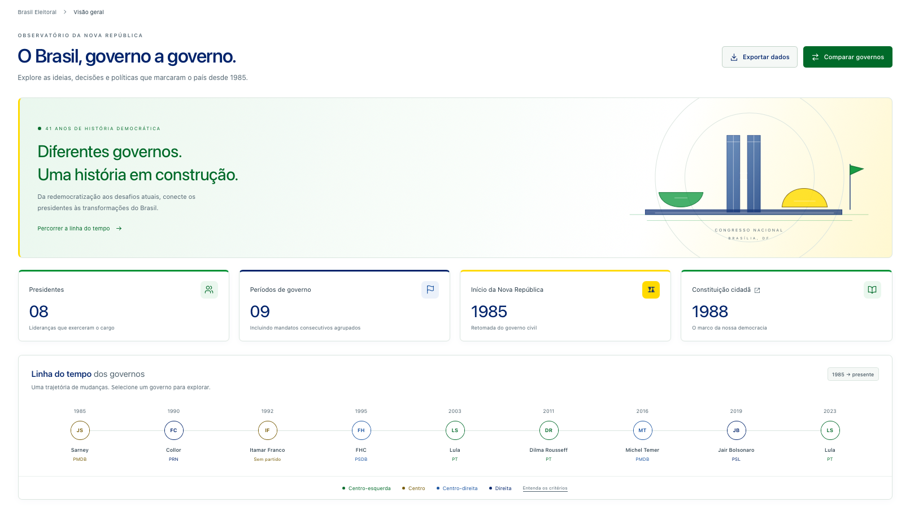

# Brasil Eleitoral



Dashboard dos presidentes que exerceram o governo desde a redemocratização em 1985. Interface em português, construída com views Rails e Tailwind CSS.

O tema tem fundo branco, verde nas ações, azul nos títulos e amarelo nos destaques. A paleta está centralizada nas variáveis de `app/assets/tailwind/application.css`.

## Stack

- Ruby 4.0.5 e Rails 8.1.4.
- PostgreSQL; desenvolvimento validado com PostgreSQL 18.
- Tailwind CSS 4 pelo `tailwindcss-rails`, com compilação local.
- Hotwire: Turbo, Stimulus e Importmap. Não exige Node ou React.
- Minitest e testes de navegador com Selenium/Chrome.

## Executar com Docker (macOS)

Instale e abra o Docker Desktop. Ruby, Rails, Bundler, PostgreSQL e Tailwind serão executados nos containers; não é necessário instalá-los no Mac. Este projeto não utiliza MongoDB nem Redis.

### 1. Abra o projeto

Se ainda não tiver o repositório:

```sh
git clone https://github.com/marcopicanco-dev/brasil-eleitoral.git
cd brasil-eleitoral
```

Se já clonou, abra o terminal na pasta existente. Opcionalmente, abra o editor com `code .`.

Confirme que `Dockerfile.dev` e `compose.yaml` estão na raiz e verifique o Docker:

```sh
docker --version
docker compose version
docker info
docker compose config --quiet
```

Se `docker info` não conectar ao servidor, aguarde o Docker Desktop terminar de iniciar.

### 2. Construa a imagem de desenvolvimento

```sh
docker compose build
```

O `Dockerfile.dev` instala as dependências do sistema, Bundler e Foreman. O `Dockerfile` original é voltado à produção.

### 3. Prepare as dependências e o banco

Adicione ao lockfile a plataforma Linux usada pelo container (inclusive em Macs Apple Silicon):

```sh
docker compose run --rm --no-deps app ruby -e 'exec "bundle", "lock", "--add-platform", Gem::Platform.local.to_s'
```

Esse comando pode atualizar o `Gemfile.lock` local. Em seguida:

```sh
docker compose run --rm app bin/setup --skip-server
```

O Compose inicia o PostgreSQL e aguarda sua disponibilidade. O setup instala as gems, prepara o banco, importa os dados e compila o Tailwind. A primeira execução pode demorar por causa dos downloads.

### 4. Inicie o projeto

```sh
docker compose up -d
docker compose ps
docker compose logs -f app
```

Acesse **http://localhost:3000**. Use `Ctrl+C` para sair dos logs; os containers continuam funcionando.

O Rails e o observador do Tailwind são iniciados pelo `bin/dev`. Os arquivos da pasta local são compartilhados com o container, permitindo editar no VS Code e acompanhar as alterações.

### 5. Confira os dados

```sh
docker compose exec app bin/rails runner 'puts [President.count, Administration.count, EconomicObservation.count].inspect'
```

Com o catálogo atual, o resultado esperado é `[8, 9, 30]`.

### Comandos do dia a dia

Execute na raiz do projeto:

| Objetivo | Comando |
| --- | --- |
| Iniciar | `docker compose up -d` |
| Parar | `docker compose stop` |
| Acompanhar logs | `docker compose logs -f app` |
| Console Rails | `docker compose exec app bin/rails console` |
| Terminal no container | `docker compose exec app bash` |
| Aplicar migrations | `docker compose exec app bin/rails db:migrate` |
| Recarregar catálogo | `docker compose exec app bin/rails db:seed` |
| Instalar gems após alterar o Gemfile | `docker compose run --rm app bundle install` |
| Reconstruir após alterar o Dockerfile.dev | `docker compose build` |
| Remover containers preservando volumes | `docker compose down` |

Após instalar gems ou reconstruir a imagem, execute `docker compose up -d` (ou `docker compose restart app` se apenas instalou gems).

### Persistência e configuração

O volume `postgres_data` preserva o banco e o volume `gems` preserva as gems. Não use `docker compose down -v` para uma parada comum: ele apaga esses volumes, incluindo o banco local.

A configuração de desenvolvimento utiliza PostgreSQL 18, host `postgres`, usuário `brasil` e senha `senha_local`, definidos no Compose. Essas credenciais são apenas para desenvolvimento. O banco não publica uma porta no Mac; a aplicação fica disponível em `127.0.0.1:3000`.

### Problemas comuns

- **Porta 3000 ocupada:** pare o processo que a utiliza ou altere o mapeamento no Compose para `127.0.0.1:3001:3000` e acesse `http://localhost:3001`.
- **Erro no build ou setup:** consulte a mensagem completa; não avance enquanto o comando falhar. Para o banco, consulte `docker compose logs postgres`.
- **Mudança em gems:** execute `bundle install` pelo container conforme a tabela e reinicie o serviço `app`.

## O que já funciona

- Dashboard com 8 presidentes e 9 períodos de governo.
- Linha do tempo com acesso aos perfis.
- Busca por nome, partido ou agenda e filtros por posição e década.
- Perfis com contexto político, economia, políticas, marcos e fontes.
- Seção “Como chegou ao poder?” com sucessões, chapas, todos os candidatos por turno e coligações eleitorais de 1985 a 2022.
- Comparação de duas gestões lado a lado.
- Gráfico do IPCA com 30 observações oficiais do IBGE, de 1995 a 2024.
- Exportação CSV em UTF-8, com os filtros selecionados.
- Layout responsivo e navegação móvel.
- Página de fontes e metodologia.

## Dados e critérios

O catálogo está em [db/data/administrations.yml](db/data/administrations.yml); a série econômica está em [db/data/ipca.json](db/data/ipca.json). A carga é idempotente.

A origem dos mandatos está em [db/data/accessions.yml](db/data/accessions.yml), que referencia por ano as eleições em [db/data/elections.yml](db/data/elections.yml). A carga resolve essas referências no campo JSONB `accession` de cada governo. Resultados, alianças e fontes também são incluídos na exportação CSV.

FHC e os mandatos consecutivos de Lula e Dilma são agrupados por período contínuo. Lula a partir de 2023 tem registro próprio. As datas usam o último dia completo anterior à sucessão; as notas distinguem exercício e titularidade. Tancredo não entra na contagem, pois não exerceu o cargo.

As posições políticas são sínteses editoriais qualitativas. As políticas são uma seleção inicial, com cobertura até 2024 no período aberto em 2023. A página **/metodologia** explica critérios, limites e fontes; o gráfico econômico não atribui causalidade aos presidentes. Veja a [proveniência dos dados](db/data/README.md).

## Verificação

Com os serviços em execução:

```sh
docker compose exec app bin/rails test
docker compose exec app bin/rails zeitwerk:check
docker compose exec app bin/rails tailwindcss:build
```

Os testes de sistema (`bin/rails test:system`) precisam de um navegador Chrome acessível ao Selenium. A imagem de desenvolvimento fornecida não inclui Chrome; esses testes exigem configuração adicional de navegador no ambiente Docker.

## Estrutura principal

- `app/controllers/dashboard_controller.rb`: páginas, filtros e exportação.
- `app/models/`: presidentes, períodos e observações econômicas.
- `app/views/dashboard/`: dashboard, perfis, comparação e metodologia.
- `app/assets/tailwind/application.css`: tema e componentes.
- `app/javascript/controllers/navigation_controller.js`: menu móvel.
- `db/seeds.rb`: importação transacional dos arquivos locais.

O projeto está preparado para desenvolvimento local.
